# Dynamic Conversations Usage Guide
This is a quick start guide for the Dynamic Converations Asset, which goes over the basic functionality and how to start creating your own dialogues.

## Getting Started
After installing the package from the package manager, you can start setting up your interface by creating a Dynamic Text object for the line display, an Image for the portraits, a button prefab for the player choices, an audio source to play line audio, etc.

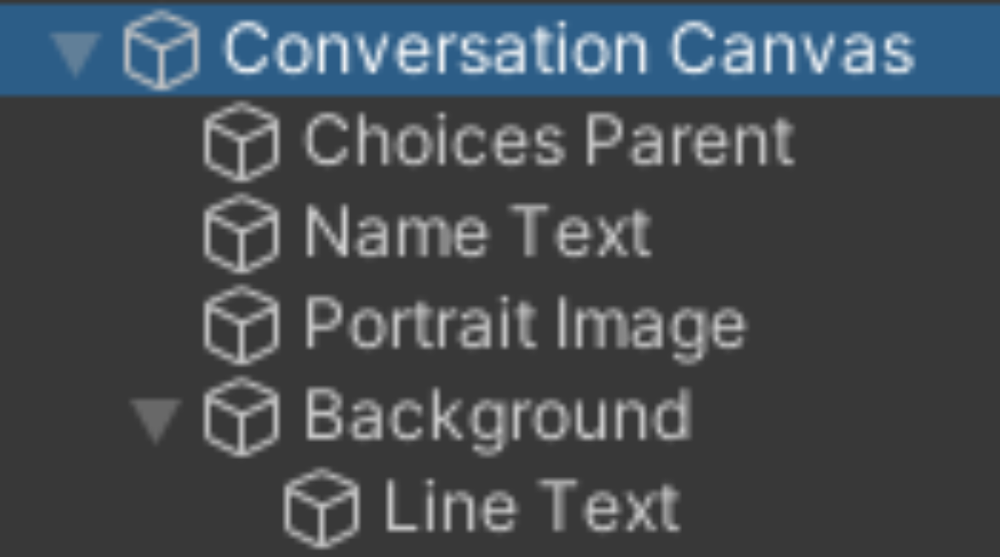

After adding all the necessary components into the Scene and assigning them into the Conversation Runner Controller you can start creating the Scriptable Objects for your conversations.

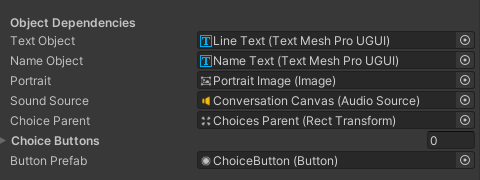

## Create Speaker Profile
Right click into your project folder, go into the create, Dynamic Tools, Conversations and start by creating a Speaker Profile object.

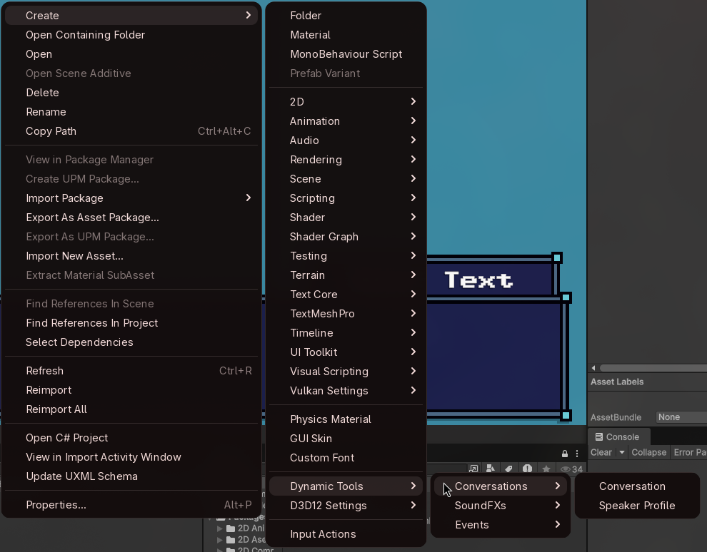

In the speaker profile object, you can set up a configuration for how to display the text such as typing speed, character name, font, dialogue portraits, sound effects and more.

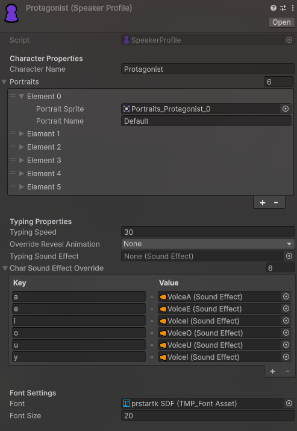

## Create Sound Effect Asset
Creating sound effect assets is also pretty simple, in the same menu select sound effect, and in the inspector add custom audio files and set up the configuration as needed. You can also preview the result by pressing the play preview button.

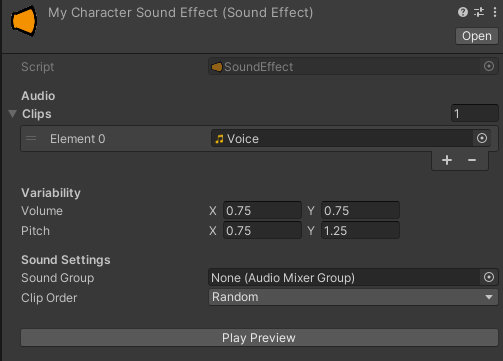

## Create a Conversation	
Then you can create and open the Conversation Tree Editor by double clicking a conversation tree asset. In this window you can start adding lines, choices, wait and event nodes by right clicking and selecting the node, and creating the connections between the nodes is as easy as dragging the output port of a node into the input node of another.

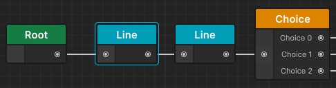

## Create a Line Node
In here you can start writing lines for your own conversation, if you want to have an interesting dynamic look you can start using the rich text implementation to add effects to the text or change certain properties of sections of the line by following this simple syntax: \<EffectTag:Value1,Value2...>Your Text</> or \<EffectTag:Property1=Value1,Property2=Value2>

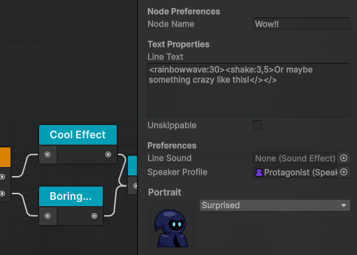

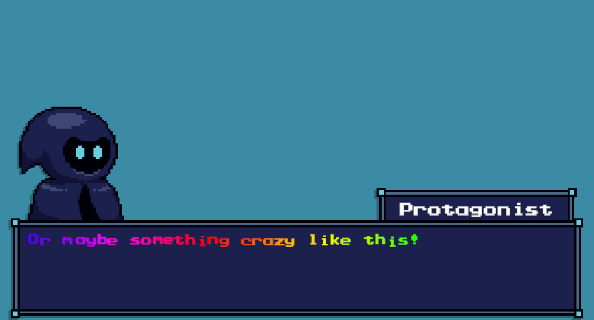

All the included effects and their tags can be found further down in the Package Contents section. 
The lines also provide a drop-down menu to select a portrait when it is available from the Current Speaker Profile.

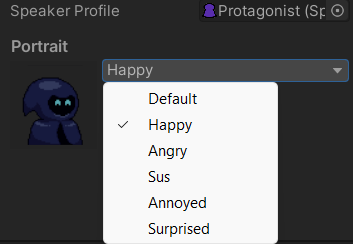

## Create Player Choices
You can use choice nodes to create branching in the conversation. Each choice option results in a different outcome.

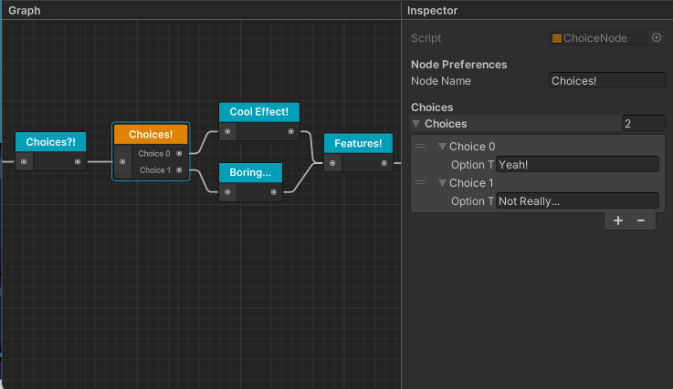

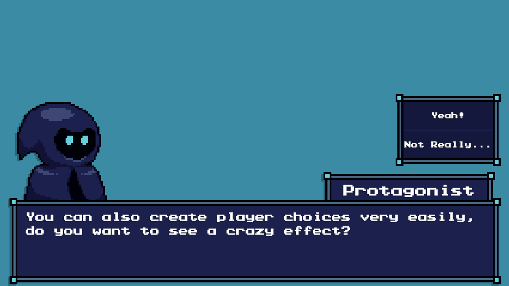

## Create Events
Additionally, you could add event nodes to call scene functions during a conversation. This can be done by creating an Event Channel Object of the desired type and then assign it to the respective node.

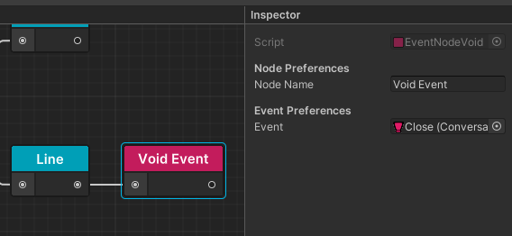

To have a function be called you will canadd the event listener of the correct type into your scene and assign both the channel object and the events to be called. Then when the conversation reaches the specified event node the channel will fire, and the functions set into the event listener will be called.

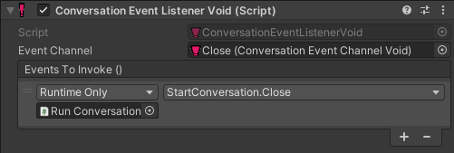

You can also directly subscribe to the event channel fromyour custom scripts!

## Use the Localization System
At the top of the editor window, you can find a language selector. This selector allows you to alternate between different versions of the conversation tree, depending on which language is set during runtime the asset will select the specified version.

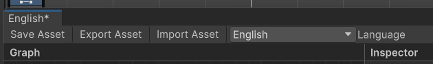

More information about the Localization system can be found in the package contents section.
Use Runtime Text Replacements
You can add custom data to be replaced in runtime by using tags encapsulated by brackets like this: [CustomTagName]. You can set the values and their respective tags by using the ConversationReplaceManager functions. For more information check out the Package Contents section.

## Start Using the Asset!
That mostly covers the entire process of creating a dialogue with events and player choices, what's left would be to create your own script to set up the inputs to call the NextLine, FinishLine, ToggleFastForward functions found in the conversation runner script. 
To further expand on the basic setup, you can subscribe your own functions into the "OnStartConversation" and "OnFinishConversation" events to handle stuff like displaying and hiding the Dialogue UI or enabling and disabling player movement, etc.