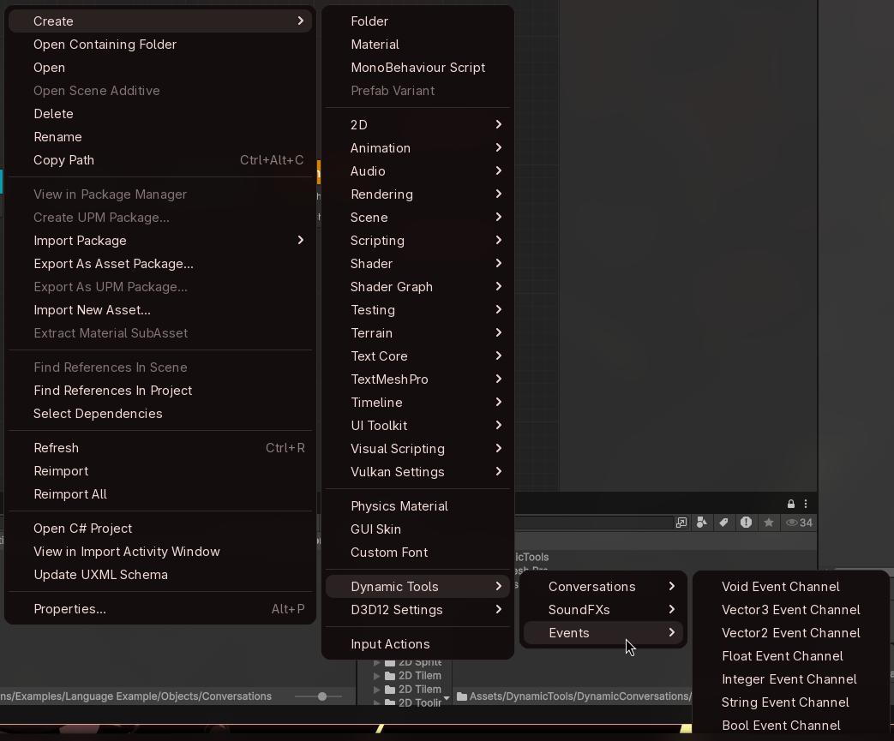
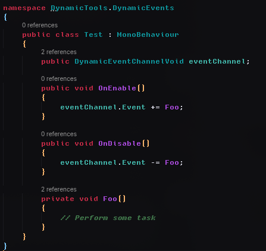

# Dynamic Events Usage Guide
This is a quick start guide for the Dynamic Events Asset.

## Event Channels
Event channels are scriptable objects that hold event references through a subscription pattern that allow objects to trigger and receive events without requiring a direct reference between them.

You can create event channels by using the create asset menu under Dynamic Tools > Events:

Each type of event refers to an additional parameter to send when invoking the event, can be used to propagate certain information directly through the event activation.

## Event Listeners
There are two options to listen to event channels:

### Event Listener Components
You can add an event listener component in your scene and assign it an event channel, this allows you to directly select functions to fire using the inspector view for Unity Events.

### Subscribe from Scripts
You can also subscribe to event channels directly into any custom script and run custom code directly from them without using event listener components. Always remember to unsubscribe to the event when the object is disposed to avoid memory leaks or unintended behavior.

