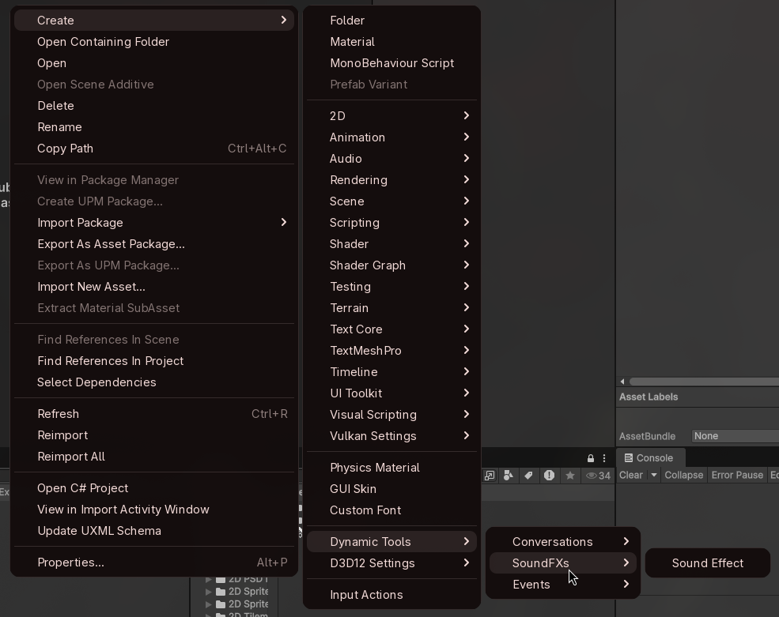

# Dynamic SoundFX Usage Guide
This guide covers the basic usage of Sound Effect Assets from the DynamicSoundFX Asset

## SoundEffect Asset
A sound effect asset is a scriptable object that hold configuration for a single instance of a sound effect type that can be reused. It allows setting up various clips, the order on which these clips are played, randomized volume and pitch when playing and the Audio Mixer Group to use when playing the sound.

To create a sound effect asset, use the create asset menu into Dynamic Tools > SoundFX

