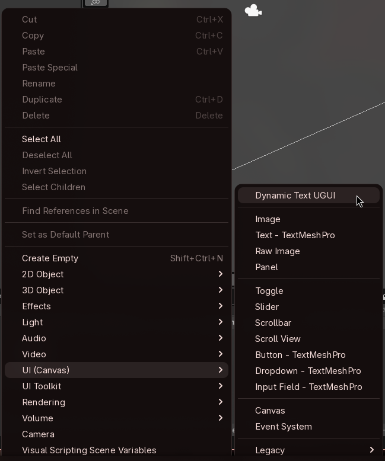
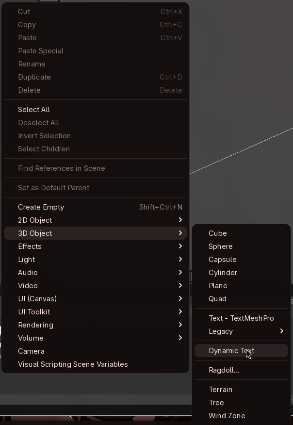
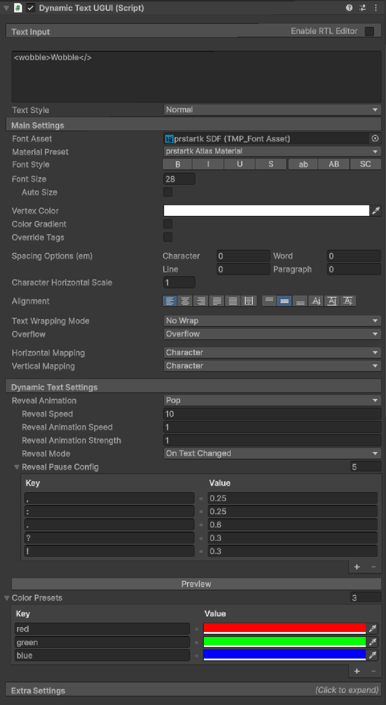
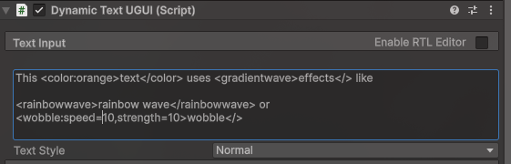
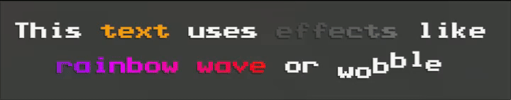
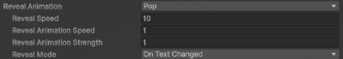
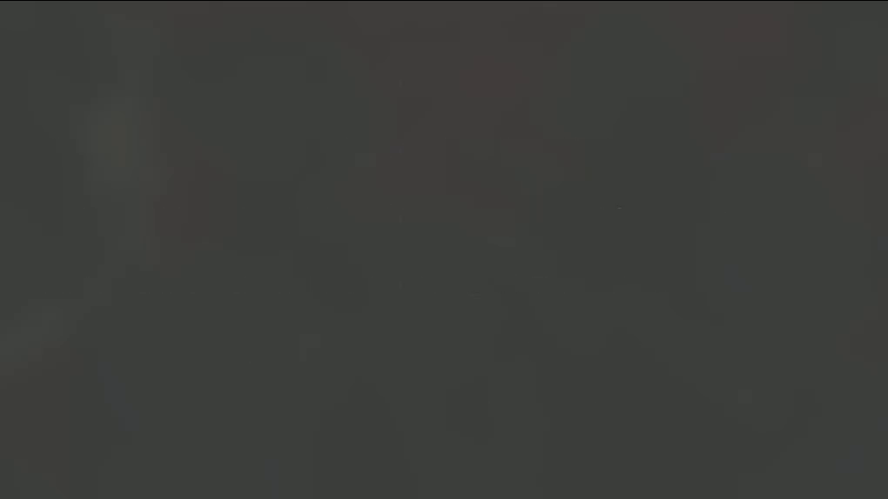
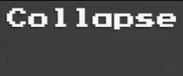
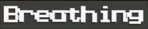
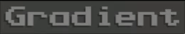

# Dynamic TextFX Usage Guide
This guide covers the basics of using Dynamic Text in your projects, as well as a reference for all existing text effects

## Dynamic Text Object
You can add a Dynamic Text Object using either UI (Canvas) > DynamicTextUGUI or 3D Object > DynamicText from the object menu.

You can also add them as components directly into an object in the scene.

## Dynamic Text UGUI vs Dynamic Text
Both objects are functionally the same, each extend from TextMeshProUGUI and TextMeshPro respectively, the only difference is that DynamicTextUGUI is meant to be used in UI Canvas, whie DynamicText can be used in 3D world space.

## Properties
In the inspector, you can edit all the basic text mesh pro properties, with the addition of the Dynamic Text Settings, where you can set up the reveal animation, custom reveal pause config to add an extra wait time after certain characters and custom color presets to create tags that can be used in the color related effects.

## Text Effects
You can add effects to the text using the custom rich-text implementation, you can checkout the reference for all effects lower down this guide.

Parsing is updated whenever the text is changed, even in edit mode.

The syntax is based on html, and follows this pattern: \<effect:property=value,property2=value>Text Content</effect>. Alternatively, you can also write it as <effect:value, value2>Text Content</> or even <effect>Text Content</> to use the default values.

## Text Reveal Animations
You can select from a variety of reveal animations. These animations cause the text to set characters as visible one by one, using the specified animation, speed and mode.

The mode defines when the text reveal is played. It can happen whenever the text is changed, only on awake, only on enable or never play automatically.

You can manually trigger a reveal animation to play calling the RevealText() function in DynamicText objects

## Text Effect References

| Name | Tag | Effect |
|---|---|---|
| Wobble | <wobble:Speed, Strength>|  |
| Shake | <shake:Speed, Strength>|  |
| Collapse | <collapse:Strength, Delay>|  |
| Color | \<color:ColorTag> or \<color:r,g,b,a>|  |
| Rainbow | \<rainbow:Speed>|  |
| Rainbow wave | \<rainbowwave:Speed>|  |
| Scale | \<scale:Strength>|  |
| Breathing | <breathing:Speed, Strength>|  |
| Fall | <fall:Strength, Start, Delay>|  |
| Gradient | <gradient:Speed, Color1, Color2, ...>|  |
| Gradient wave | <gradientwave:Speed, Color1, Color2, ...>|  |