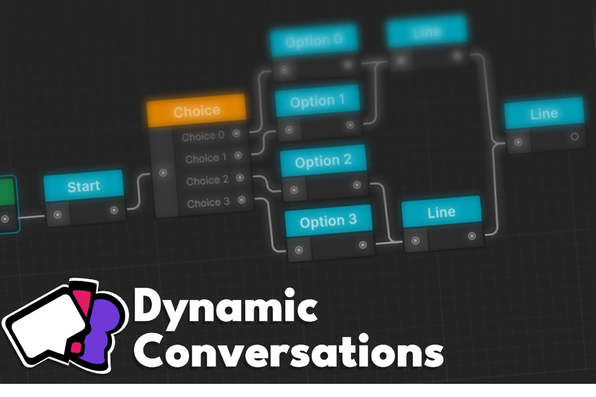

# Dynamic Tools Docs
Welcome to the official documentation for the Dynamic Tools suite of Unity Assets!

You can get the Tools from [my page on the Unity Asset store!](https://assetstore.unity.com/publishers/88927)

If you're enjoying the tools feel free to leave a review or rating to the assets, it helps out a ton!

The assets are sold separately, but you get any dependencies for free! 
(Ex: Buying Dynamic Conversations gives free access to Dynamic SoundFX, Dynamic TextFX and Dynamic Events)

## Guides
Here you can access some usage guides for specific assets!

* [Dynamic Conversations](./DynamicConversations/guides.md)
* [Dynamic TextFX](./DynamicTextFX/guides.md)
* [Dynamic SoundFX](./DynamicSoundFX/guides.md)
* [Dynamic Events](./DynamicEvents/guides.md)

## API Reference
Here you can access the full documentation for all classes, methods and properties from the C# code.

The reference includes the documentation for the entire suite of tools, inside you can check information about classes, namespaces, methods and properties for every single asset in the suite.

* [View Reference Index](../../api/DynamicTools.html)

## About the assets
These assets were created by SoyVixterDev (that's me!)

They started as tools to be used in my own projects, but evolved into something larger, and I took it as a chance to provide it as a tool and side project as a Unity Asset for the Asset Store.

Originally, the entire project was under the Dynamic Conversations umbrella, but I eventually decided to compartmentalize it into different tools, so every project can import which ever match their needs.

The main appeal of the suite is still the Dialogue system, but it now counts with some useful systems and utilities to quickly improve workflows or game polish.

## Contact
For any inquiries or bug reports you can contact me via email at [soyvixterdev@gmail.com]()